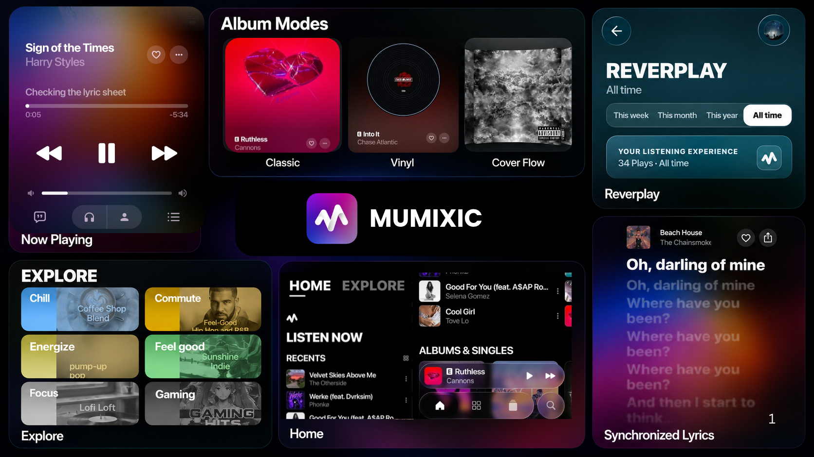

 
 

# Mumixic

### YouTube Music Client in Rich UI for Android

 

 

[**Download**](#download) · [**Features**](#features) · [**Credits & Licenses**](#credits-and-licenses) · [**Disclaimer**](#disclaimer)

 

> [!IMPORTANT]
> Mumixic is an independent client not affiliated with, endorsed by, or connected to YouTube or Google LLC in any way.

---

<h1>Features</h1>

<table>
  <tr>
    <td width="50%" valign="top">

#### 🎵 Playback & Audio Engine
- **Search, browse and stream** anything available on YouTube Music.
- **Hi-Res lossless audio** — FLAC/ALAC up to 24-bit / 32-bit float PCM at 192kHz with direct USB DAC output bypass.
- **Dolby Atmos & Spatial Audio** detection and hardware codec decoding.
- **Smart Version Alignment** — analyzes waveform/envelope to synchronize music video and official audio releases.
- **Gapless playback with true crossfade**, adjustable from 0–12s.
- **Automix [Beta]** — DJ-style transitions with real-time tempo-stretching and beat-matching.
- **Offline downloads** — save high-quality tracks with embedded cover art and metadata.
- **Local music library** integration with automatic device audio scanning.
- **Background playback** via Android MediaSession with lockscreen media controls.
- **Custom Headphone Gestures** — configure previous track vs. rewind on headphone button presses.

#### 🌐 Connectivity & Sync
- **Listen Together** — host or join synchronized real-time listening parties with low-latency websockets.
- **Sign in with your Google account** for personal playlists, subscriptions, and history.
- **Spotify integration** — link your Spotify account to import playlists and Liked Songs.
- **Discord Rich Presence** — display current song, artist, album, and live elapsed progress.
- **Scrobbling** — native Last.fm and ListenBrainz integration with offline scrobble caching.
- **Pluggable source modules** — add, configure, test, and health-check external media sources.

    </td>
    <td width="50%" valign="top">

#### ✨ Design & Visual Experience
- **Ultra-Smooth 120Hz/144Hz** — High Performance Mode enabled by default for fluid animations.
- **Seamless Backdrop Blurs** — smooth album-mesh crossfading with dark zero-flash transitions between songs.
- **Custom Background Wallpapers** — set your own photo with persistent storage, opacity slider, and dynamic glass scrims.
- **REVERPLAY** — Apple Music Replay style listening recap stories, top tracks/artists statistics, and shareable glass posters.
- **Windows Phone Tab Switcher** — bold, high-legibility typographic tab navigation.
- **Frosted Liquid Glass (Haze)** — translucent navigation bars, dynamic blurs, and Material 3 design tokens.
- **Animated album canvas** — motion artwork video backdrops on the Now Playing screen.
- **Word-synced Apple-like lyrics** — syllable-level highlighting and smooth focus animations (credit: [binimum](https://github.com/binimum/am-lyrics)).
- **Lyrics Providers & Translation** — LRCLIB, Musixmatch, Genius, KuGou, BiniLyrics, PaxSenix, and live translation.

#### ⚙️ Convenience & Updates
- **In-App OTA Updates** — check for updates directly with background APK download and one-tap install.
- **Per-network audio quality** — separate quality ceilings for Wi-Fi and cellular networks.
- **Playback speed control** (0.5×–2.0×) and intelligent **skip silence**.
- **Sleep timer** — preset intervals or "stop after current song".
- **System equalizer** and Stats for Nerds overlay.

    </td>
  </tr>
</table>

---

<h1>Download</h1>

Grab the latest signed APKs directly from the [Releases](https://github.com/rishirishith18/Mumixic/releases) page. Sideloading requires enabling "Install unknown apps" for the browser or file manager downloading the APK.

---

<h1>Credits and Licenses</h1>

This is an unofficial port of [BitChord by Kushagra Singh](https://github.com/kushagrasinghx/BitChord). The upstream source is pinned as a Git submodule at [fe198ac](https://github.com/kushagrasinghx/BitChord/tree/fe198ac); its source, per-file notices, and license are available in `vendor/bitchord-upstream` when the submodule is initialized. See the upstream repository's [maintainers and contributors](https://github.com/kushagrasinghx/BitChord/blob/fe198ac/MAINTAINERS.md) for upstream attribution.

YouTube stream extraction uses [InnerTubeX](https://github.com/MetrolistGroup/innertubex), the maintained resolver used by Android upstream. Its source is vendored at revision `a6ca8cb76e9c347d4f21824ca9f19b9db2e5aebd` in `vendor/innertubex`, with its GPLv3 license and notices retained.

Some analyzer code was ported from [Orchard](https://github.com/SFG5453/Orchard), by SFG545, through BitChord's Android implementation. The relevant files identify SFG545 and Kushagra Singh and retain their AGPLv3-or-later terms. The audio clarity contour also credits the [LastWave-native](https://github.com/Clash-Projects/LastWave-native) reference in its source and notices. The upstream README credits [binimum/am-lyrics](https://github.com/binimum/am-lyrics) for the Apple-like lyrics animation; that credit is preserved here.

---

<h1>Disclaimer & Legal Notice</h1>

Mumixic is an independent, community-driven third-party audio player and client. It is **not** associated with Google LLC, YouTube Music, Deezer, Telegram, or any of their parent companies.

* **No Media Hosting:** Mumixic does not host, upload, or store copyrighted music files. It operates strictly as an interface to scan local device storage or stream media directly from public, public-facing, or user-authenticated APIs.
* **Fair Use & API Usage:** This software is created solely for personal research, educational, and fair-use purposes. The user is entirely responsible for ensuring their usage aligns with their local copyright laws and YouTube Terms of Service.
* **No Ad-Blocking Guarantee:** While Mumixic focuses on providing a clean listening environment, it does not guarantee permanent bypasses or modifications to commercial third-party platform conditions.
* **Copyleft:** Mumixic is free software under the GPLv3. The license does not let anyone forbid others from selling or redistributing copies, but any distribution must come with the Corresponding Source under the same license.

---

<h1>License</h1>

This project is licensed under the **GNU General Public License v3.0 (GPLv3)**. See the [LICENSE](LICENSE) file for details.

